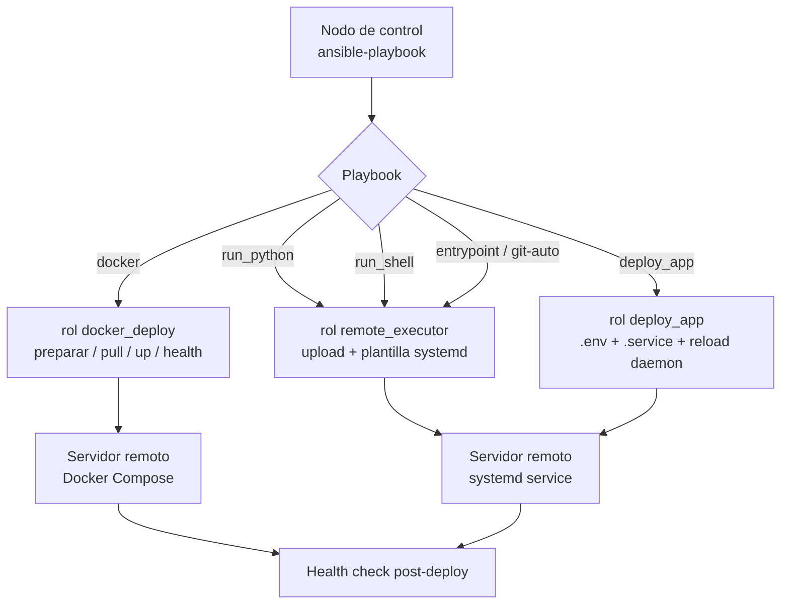

# Deployer

Sistema de despliegue automatizado con Ansible. Soporta aplicaciones Python, shell scripts, Docker Compose y repositorios Git en servidores remotos, con health checks post-deploy y gestión vía systemd.

## Contenido

- [Características](#características)
- [Arquitectura](#arquitectura)
- [Stack](#stack)
- [Estructura del repositorio](#estructura-del-repositorio)
- [Instalación](#instalación)
- [Uso](#uso)
- [Playbooks](#playbooks)
- [Roles](#roles)
- [Inventarios](#inventarios)
- [Configuración](#configuración)
- [Roadmap](#roadmap)
- [Licencia](#licencia)

## Características

- Despliegue de aplicaciones Python, shell scripts y entrypoints.
- Gestión de contenedores Docker Compose (pull, up, health checks).
- Health checks post-deploy.
- Soporte multi-entorno (dev, staging, prod).
- Ejecución remota con systemd para persistencia.
- Rollback y cleanup.

## Arquitectura



## Stack

- Ansible (2.9+)
- YAML
- Bash
- Docker / Docker Compose
- Makefile (targets de orquestación)

## Estructura del repositorio

```
ansible-deployer/
├── ansible.cfg
├── Makefile                # make shell / python / deploy / status / ...
├── collections/requirements.yml
├── playbooks/
│   ├── site.yml            # Orquestador principal
│   ├── deploy.yml          # Deploy Docker Compose
│   ├── run_python.yml
│   ├── run_shell.yml
│   ├── run_entrypoint.yml
│   ├── run_git_repo_auto.yml
│   ├── install_docker.yml
│   ├── stop.yml
│   ├── status.yml
│   └── cleanup.yml
├── roles/
│   ├── docker_deploy/      # Ciclo de vida de stacks Docker Compose
│   ├── deploy_app/         # Templates systemd (.env, .service)
│   └── remote_executor/    # Python, shell, entrypoint, git
├── inventories/
│   ├── prod/               # hosts.yml, hosts.ini, group_vars
│   ├── staging/
│   └── dev/
├── composes/               # Templates Docker Compose
├── examples/               # Apps de ejemplo (python, shell, compose, entrypoint, gitlab-auto)
└── group_vars/all.yml
```

## Instalación

Requisitos: Ansible 2.9+ en el nodo de control, Python 3.8+ y acceso SSH a los servidores remotos (Docker/Docker Compose en los nodos gestionados para el deploy de contenedores).

```bash
git clone https://github.com/bi0punk/deployer.git
cd deployer/ansible-deployer
ansible-galaxy collection install -r collections/requirements.yml
```

## Uso

Vía Makefile (recomendado):

```bash
make install           # instala colecciones
make check             # verifica conectividad (ansible -m ping)
make deploy            # deploy interactivo de Docker Compose
make python            # ejecuta app Python remota
make shell             # ejecuta script shell remoto
make entrypoint        # ejecuta entrypoint remoto
make git-auto          # clona repo y autodetecta ejecución
make status            # estado de proyectos Docker
make stop              # detiene proyecto
make cleanup           # limpia recursos Docker
make cleanup-all       # limpia todo (imágenes, volúmenes, redes)
make install-docker    # instala Docker en servidores remotos
make lint              # valida sintaxis de todos los playbooks
make list-projects     # lista composes disponibles
```

Vía ansible-playbook directamente (con inventario por entorno):

```bash
ansible-playbook -i inventories/prod/hosts.yml playbooks/deploy.yml
ansible-playbook -i inventories/prod/hosts.yml playbooks/run_python.yml
ansible-playbook -i inventories/prod/hosts.yml playbooks/status.yml
ansible-playbook -i inventories/prod/hosts.yml playbooks/stop.yml
ansible-playbook -i inventories/prod/hosts.yml playbooks/install_docker.yml
```

## Playbooks

| Playbook | Descripción |
|---|---|
| `site.yml` | Orquestador principal |
| `deploy.yml` | Deploy de stacks Docker Compose |
| `run_python.yml` | Sincroniza y ejecuta app Python como systemd |
| `run_shell.yml` | Sincroniza y ejecuta script shell como systemd |
| `run_entrypoint.yml` | Ejecuta entrypoint personalizado |
| `run_git_repo_auto.yml` | Clona repo Git y ejecuta |
| `install_docker.yml` | Instala Docker en nodos remotos |
| `stop.yml` | Detiene servicios gestionados |
| `status.yml` | Muestra estado de servicios |
| `cleanup.yml` | Limpia artefactos de deploy |

## Roles

- **docker_deploy**: gestiona el ciclo de vida de stacks Docker Compose (preparar directorios, sincronizar archivos, pull de imágenes, compose up y health checks).
- **deploy_app**: prepara directorios, despliega templates systemd (`.env`, `.service`) y recarga el daemon en nodos remotos.
- **remote_executor**: ejecución remota genérica para apps Python, shell scripts, entrypoints personalizados y clonado de repos Git.

## Inventarios

```
inventories/
├── prod/        # Producción (hosts.yml, hosts.ini, group_vars)
├── staging/     # Pre-producción
└── dev/         # Desarrollo
```

Cada entorno define sus propios `hosts` y `group_vars`. El ejemplo `examples/gitlab-auto.example.yml` muestra integración con GitLab CI.

## Configuración

Variables globales en `group_vars/all.yml`:

| Variable | Default | Descripción |
|---|---|---|
| `docker_deploy_base_path` | `/opt/docker-projects` | Ruta base en el servidor remoto |
| `local_composes_path` | `{{ playbook_dir }}/../composes` | Compose locales |
| `docker_pull_always` | `true` | Pull antes de levantar |
| `docker_force_recreate` | `false` | Recrear contenedores aunque no cambien |
| `docker_remove_orphans` | `true` | Eliminar contenedores huérfanos |
| `backup_before_deploy` | `false` | Backup de volúmenes antes de desplegar |
| `deploy_health_check_delay` | `10` | Segundos de espera antes de verificar salud |
| `docker_compose_bin` | `docker compose` | Comando de Docker Compose (plugin v2) |
| `deploy_env` | `production` | Entorno de despliegue |

## Roadmap

- [x] Deploy multi-entorno (dev, staging, prod)
- [x] Ejecución remota Python/shell/entrypoint/git
- [x] Instalación de Docker y health checks
- [ ] Notificaciones (Slack) activadas por defecto
- [ ] Soporte para más stacks (Kubernetes, systemd nativo)

## Licencia

Sin archivo LICENSE declarado en el repositorio.